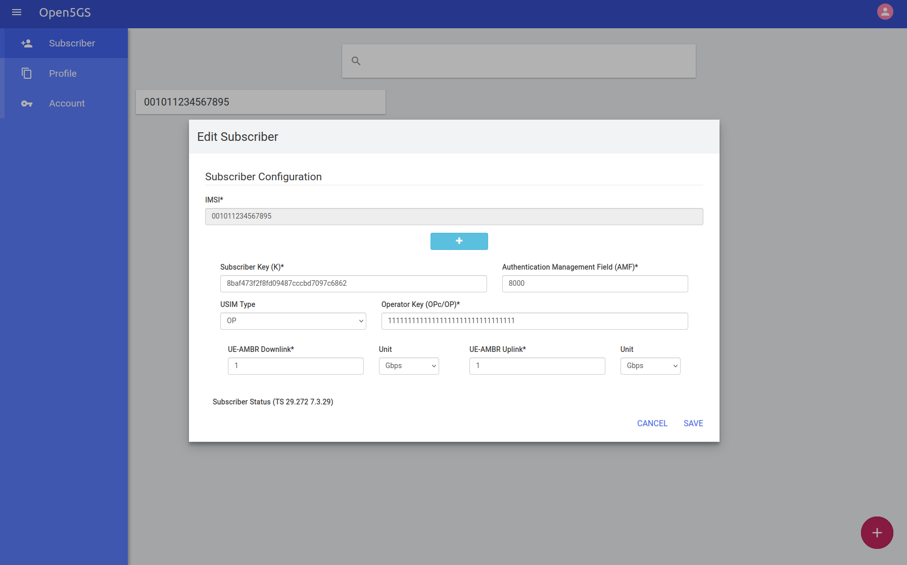
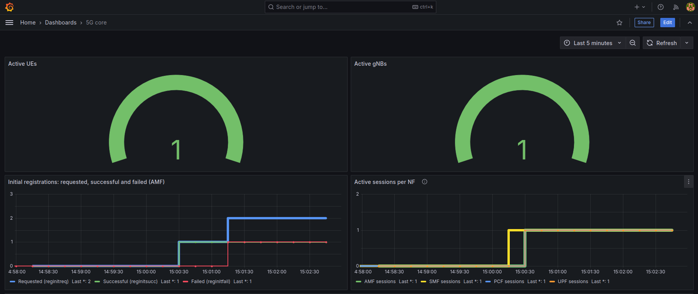
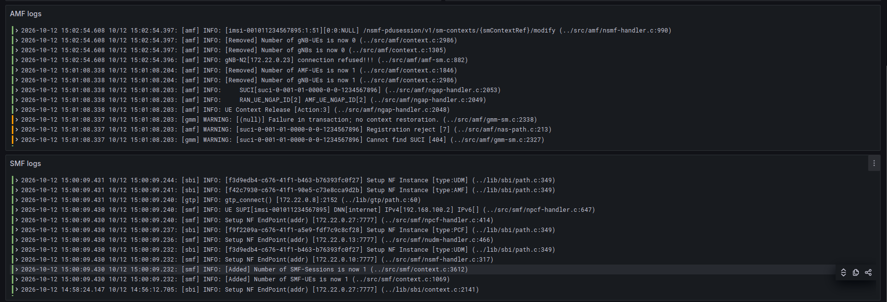
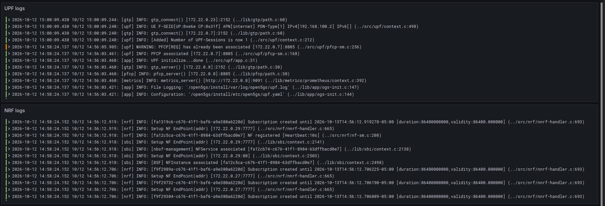
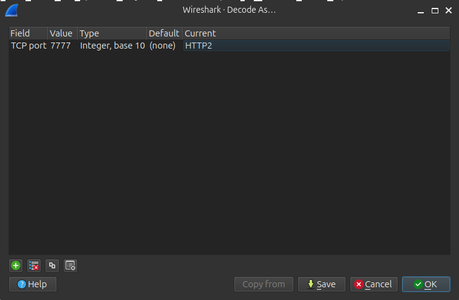

# Moviles-Lab-7-5G

## Prerequisites

Install Docker from the official guide:
https://docs.docker.com/engine/install/ubuntu/#install-using-the-repository

Add the current user to the docker group:

```
sudo usermod -aG docker $USER
newgrp docker
```

## Pull Open5GS image

```
docker pull ghcr.io/herlesupreeth/docker_open5gs:master
docker tag ghcr.io/herlesupreeth/docker_open5gs:master docker_open5gs
```

## Build UERANSIM image

From the repository root:

```
cd ueransim
docker build -t docker_ueransim:latest .
cd ..
```

## 5G registration and PDU session establishment

### 5G SA deployment without SCP

```
docker compose -f core.yaml up -d
docker compose -f core.yaml ps
```

### Prometheus, Loki, Promtail and Grafana deployment

```
docker compose -f observability.yaml up -d
docker compose -f observability.yaml ps
```

### Provision UE through WebUI

1. Open in a web browser `http://<VM-IP>:9999`
2. Log in with `admin` and `1423`
3. Create the following subscriber:

| Field              | Value                              |
| ------------------ | ---------------------------------- |
| IMSI               | 001011234567895                    |
| Subscriber Key (K) | 8baf473f2f8fd09487cccbd7097c6862   |
| Operator Key (OP)  | 11111111111111111111111111111111   |
| AMF                | 8000                               |
| Slice (S-NSSAI)    | SST 1                              |
| DNN                | internet, IPv4                     |



### Capture traffic on docker bridge interface

On a second terminal, start the capture **before** deploying the RAN components:

```
sudo tcpdump -i br-open5gs -nn -U -w 5g.pcap 'sctp port 38412 or udp port 8805 or udp port 2152 or tcp port 7777 or icmp'
```

### Deploy RAN components

Deploy the RAN components to execute the 5G scenario:

```
docker compose -f ran.yaml up -d nr_gnb
docker compose -f ran.yaml up -d nr_ue
```

Wait for the registration and PDU session, then generate user traffic:

```
docker exec nr_ue ping -I uesimtun0 -c 10 8.8.8.8
```

Execute the failure scenario (deploys UE that uses an unprovisioned IMSI):

```
docker compose -f ran.yaml up -d nr_ue_fail
```

### Access Grafana

1. Open in a web browser  `http://<VM-IP>:3000`
2. Log in with `open5gs` and `open5gs`
3. Navigate to the 5G core dashboard to view metrics and logs





### Conclude scenario

Stop RAN containers:

```
docker compose -f ran.yaml down
```

Stop the traffic capture with `Ctrl+C` in the second terminal

Finally, remove the remaining containers:

```
docker compose -f observability.yaml down -v
docker compose -f core.yaml down -v
```

### Visualize traffic in Wireshark

Open the pcap file from the traffic capture in Wireshark

Open5GS SBI uses unencrypted HTTP/2 on port 7777, which Wireshark does not recognize on its own. It has to be told how to decode it:
 
1. Go to **Analyze > Decode As...**
2. Click + and fill in each column:

| Column  | Value                          |
| ------- | ------------------------------ |
| Field   | `TCP port`                     |
| Value   | `7777`                         |
| Default | `(none)`                       |
| Current | `HTTP2` (do not leave it blank) |


 
3. Accept and apply the `http2` filter.

4. Aplly the following filter to view 5G traffic

```
ngap || nas-5gs || pfcp || http2.headers || gtp || icmp
```
